  <picture>
    <source media="(prefers-color-scheme: dark)" srcset="./assets/banner.svg">
    <source media="(prefers-color-scheme: light)" srcset="./assets/banner-light.svg">
    
  </picture>

  

  

 

### 👤 关于我

AI 安全方向开发者，主要在做一件事：**让模型有能力碰真实数据库，同时没有能力搞坏它**。

平时也用 Vue / JavaScript 写点小玩具，顺手折腾自己的网络和构建环境。代码大多以 MIT 协议开源。

 

### 🧩 项目

| 项目 | 一句话 | 技术栈 |
| :--- | :--- | :--- |
| [**sql_mcp**](https://github.com/jidixueqiao/sql_mcp) | SQL MCP Server：风险分级 + 两阶段 DANGER 确认 + 防篡改审计，让 AI 敢连生产库 | `Python` `MCP` `MySQL` `PostgreSQL` `SQLite` |
| [**ai-minesweeper**](https://github.com/jidixueqiao/ai-minesweeper) | 用 cursor ai 写出来的扫雷游戏，Vue 实现 | `Vue` `MIT` `Pages` |
| [**person-web**](https://github.com/jidixueqiao/person-web) | 个人网站 | `JavaScript` `Pages` |

 

### 📬 联系

  
  

 

  最后更新于 <code>2026-10-30</code> · 可视层由 <code>assets/</code> 中的 SVG 驱动

